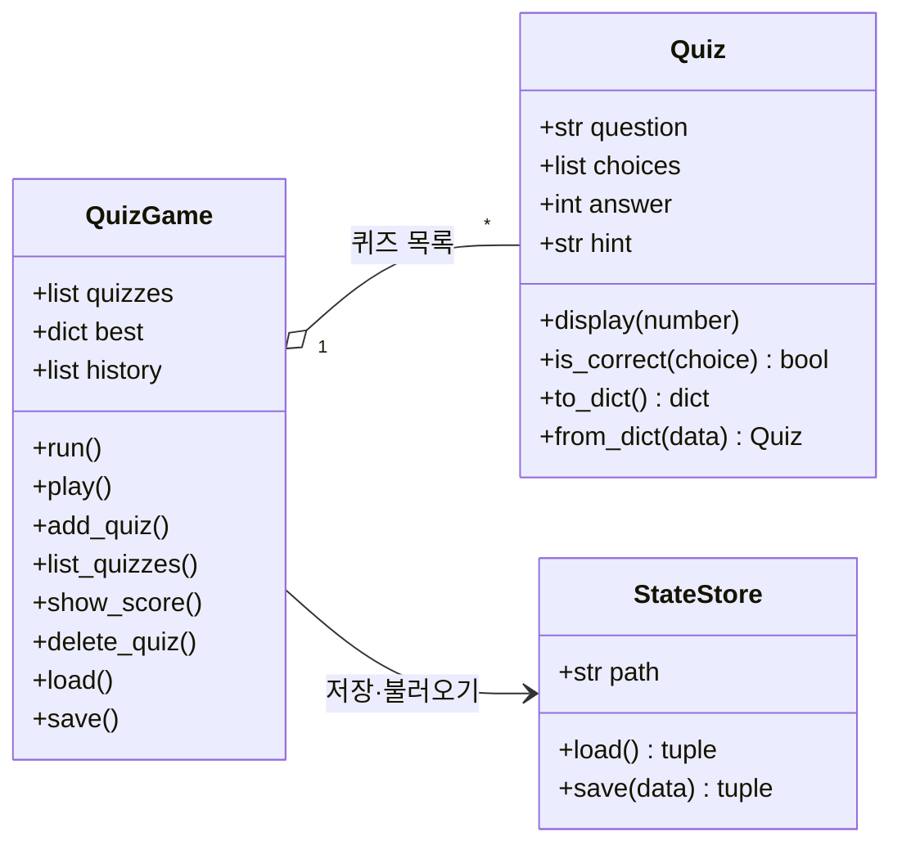
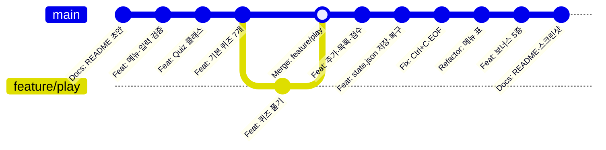
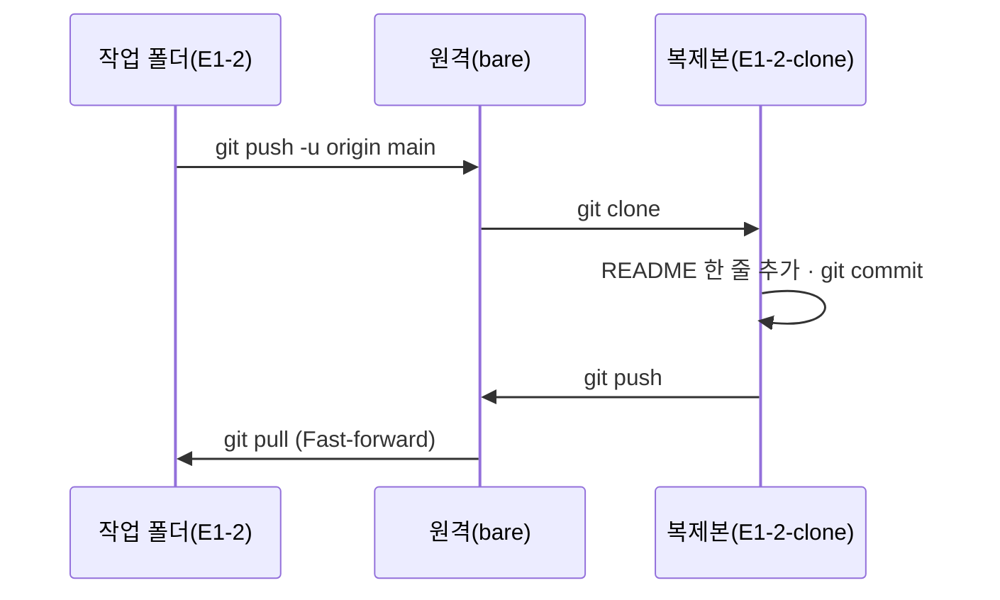

<div align="center">

# 🎯 나만의 퀴즈 게임

### AI·개발 기초 상식을 콘솔에서 — 파이썬 클래스 · 파일 저장 · Git 브랜치


-F05032?logo=git&logoColor=white)


AI올인원 입학연수 · 개발 입문


</div>

---

## 🧒 쉽게 말하면

> 공책에 퀴즈를 적어 두고, 친구에게 하나씩 내 주는 놀이를 컴퓨터로 옮긴 것이다.
> 번호를 눌러 **퀴즈를 풀고, 새 퀴즈를 적어 넣고, 점수를 본다.**
> 공책(`state.json` 파일)에 적어 두니까 **컴퓨터를 껐다 켜도 내가 넣은 퀴즈와 최고 점수가 그대로 남아 있다.**

만드는 동안 파이썬의 기본(변수·조건·반복·함수·클래스·파일 저장)과 Git(작업 기록 남기기)을 한 번씩 다 써 보게 된다.

> [!TIP]
> **처음이면 [준비물](#-준비물) → [따라 하기](#-따라-하기) 두 절만 보면 된다.** 그 아래 1~11절은 과제 채점용 기록(구조·데이터 형식·Git 이력)이다.

## 📚 목차
- 처음 하는 사람: [쉽게 말하면](#-쉽게-말하면) · [준비물](#-준비물) · [따라 하기](#-따라-하기) · [용어 사전](#-용어-사전)
- 과제 기록: [1. 개요](#-1-프로젝트-개요) · [2. 주제](#-2-퀴즈-주제와-선정-이유) · [3. 실행 방법](#️-3-실행-방법) · [4. 기능 목록](#-4-기능-목록) · [5. 실행 화면](#️-5-실행-화면) · [6. 파일 구조](#-6-파일-구조) · [7. state.json](#-7-데이터-파일--statejson)
- Git: [8. Git 작업 기록](#-8-git-작업-기록) · [9. 복제 실습](#-9-복제-실습clone--push--pull) · [10. 설명](#-10-설명) · [11. 과정 연결](#-11-과정-연결)

## 🧰 준비물
아무것도 몰라도 된다. 아래만 있으면 된다.

| 필요한 것 | 어떻게 확인하나 | 없으면 |
|---|---|---|
| 💻 컴퓨터 1대 | Windows · macOS · Linux 아무거나 | — |
| ⌨️ 터미널(글자로 명령을 치는 창) | Windows: 시작 메뉴에서 `PowerShell` 검색 · macOS: `⌘ + Space` → `터미널` · Linux: `Ctrl + Alt + T` | 모든 컴퓨터에 이미 들어 있다 |
| 🐍 Python 3.10 이상 | 터미널에 `python3 --version`(Windows 는 `python --version`) → `Python 3.12.4` 처럼 3.10 이상이면 OK | [python.org](https://www.python.org/downloads/) 에서 받아 설치. Windows 는 설치 첫 화면의 **「Add python.exe to PATH」를 꼭 체크** |
| 🌱 Git (8·9절의 기록을 직접 볼 때만) | `git --version` → `git version 2.…` | [git-scm.com](https://git-scm.com/downloads) 에서 설치. 게임만 할 거면 없어도 된다 |

- 추가로 설치할 것(라이브러리)은 **없다**. 파이썬에 처음부터 들어 있는 기능만 쓴다.
- 이 문서의 명령은 macOS·Linux 기준으로 `python3` 라고 썼다. **Windows 에서는 `python3` 대신 `python` 이라고 친다.**
- 이 저장소는 Python 3.14.8 · Git 2.56.0 에서 만들고 확인했다.

## 🚶 따라 하기
천천히 해도 10분이면 끝난다. 각 단계마다 **칠 것 → 나와야 하는 화면 → 무슨 뜻인지** 순서로 적었다.

1. **파일을 받는다.**
   [GitHub 저장소 페이지](https://github.com/dicia-jhoh/codyssey-aio-e1-2)에서 초록색 **[Code]** 버튼 → **[Download ZIP]** 을 누르고 압축을 푼다.
   Git 을 쓸 줄 알면 `git clone https://github.com/dicia-jhoh/codyssey-aio-e1-2.git` 도 된다(8절 Git 기록까지 같이 받아진다).

2. **터미널에서 그 폴더로 들어간다.** `cd ` 까지 치고(뒤에 빈칸 하나), 압축을 푼 폴더를 터미널 창으로 **끌어다 놓으면** 경로가 자동으로 써진다. 그다음 Enter.
   ```bash
   # 파일 목록 보기 (Windows PowerShell 에서도 ls 가 된다)
   ls
   ```
   👀 `main.py`, `quiz_game`, `state.json` 이 보이면 제자리에 온 것이다.

3. **게임을 켠다.**
   ```bash
   # 게임 실행 (Windows 는 python main.py)
   python3 main.py
   ```
   👀 이렇게 나오면 성공이다.
   ```text
   📂 저장된 데이터를 불러왔습니다. (퀴즈 7개, 최고점수 기록 없음)

   ========================================
          🎯 나만의 퀴즈 게임 🎯
   ========================================
   1. 퀴즈 풀기
   2. 퀴즈 추가
   3. 퀴즈 목록
   4. 점수 확인
   5. 퀴즈 삭제
   6. 종료
   ========================================
   선택:
   ```
   💬 무슨 뜻? 공책(`state.json`)을 열어 보니 퀴즈 7개가 있고, 아직 아무도 안 풀어서 최고 점수가 없다. 이제 번호를 고르면 된다.
   🆘 `python3: command not found`(또는 `'python3'은(는) … 아닙니다`)가 나오면 `python main.py` 로 다시 친다. 그래도 안 되면 준비물 표대로 Python 을 설치한다.

4. **어떤 퀴즈가 있는지 본다.** `선택:` 에 `3` 을 치고 Enter.
   👀 `📋 등록된 퀴즈 목록 (총 7개)` 아래에 `[1] 터미널에서 지금 있는 폴더의 전체 경로를 출력하는 명령은?` 부터 7문제가 나온다.

5. **퀴즈를 푼다.** `1` → `몇 문제를 풀까요? (1-7):` 에 `2` → 문제마다 정답 번호(1~4)를 친다. 모르겠으면 **`0` 을 치면 힌트**가 나온다(힌트를 본 문제는 맞혀도 점수가 절반).
   👀 문제 순서는 매번 무작위라 다를 수 있다. 이런 모양이면 성공이다.
   ```text
   [문제 1]
   파일 권한 755 에서 '그룹' 사용자가 가진 권한은?
   1. 읽기·쓰기·실행
   2. 읽기·실행
   3. 읽기만
   4. 권한 없음
   정답 입력 (힌트는 0): 2
   ✅ 정답입니다!
   ...
   🏆 결과: 2문제 중 1문제 정답! (50점)
   🎉 새로운 최고 점수입니다!
   ```

6. **내 퀴즈를 하나 만든다.** `2` 를 누르면 차례로 물어본다. 예를 들어 이렇게 친다.

   | 화면에 나오는 말 | 칠 것(예) |
   |---|---|
   | `문제를 입력하세요:` | `파이썬에서 화면에 글자를 출력하는 함수는?` |
   | `선택지 1:` ~ `선택지 4:` | `print` → `input` → `len` → `range` |
   | `정답 번호 (1-4):` | `1` |
   | `힌트 (없으면 Enter):` | `프린트` (힌트가 필요 없으면 그냥 Enter) |

   👀 `✅ 퀴즈가 추가되었습니다!` 가 나오면 성공이다. 이 순간 공책(`state.json`)에 바로 저장된다.

7. **점수를 보고 끈다.** `4` 를 누르면 방금 받은 점수가 나온다(숫자·시각은 사람마다 다르다).
   ```text
   🏆 최고 점수: 50점 (2문제 중 1문제 정답)
   🗂️ 최근 기록 1회 (전체 1회)
     2026-10-21 20:35:33  2문제 중 1문제 정답 · 힌트 1회 · 50점
   ```
   그다음 `6` 을 누르면 `👋 게임을 종료합니다.` 와 함께 꺼진다.

8. **다시 켜서 「기억하는지」 확인한다 — 이게 이 과제의 핵심이다.**
   ```bash
   # 같은 명령으로 다시 실행
   python3 main.py
   ```
   👀 첫 줄이 이렇게 바뀌어 있으면 성공이다(점수 숫자는 5단계에서 받은 점수).
   ```text
   📂 저장된 데이터를 불러왔습니다. (퀴즈 8개, 최고점수 50점)
   ```
   💬 무슨 뜻? 프로그램을 껐다 켰는데도 6단계에서 넣은 퀴즈(7개 → **8개**)와 점수가 남아 있다. 공책에 적어 뒀기 때문이다.

9. **일부러 틀리게 쳐 본다.** `선택:` 에 `abc`, `9`, 그냥 Enter 를 차례로 쳐 본다.
   👀 꺼지지 않고 이렇게 다시 물어보면 성공이다.
   ```text
   선택: ⚠️ 잘못된 입력입니다. 1-6 사이의 숫자를 입력하세요.
   선택: ⚠️ 잘못된 입력입니다. 1-6 사이의 숫자를 입력하세요.
   선택: ⚠️ 입력이 비어 있습니다. 1-6 사이의 숫자를 입력하세요.
   ```
   `Ctrl + C` 를 눌러도 오류 화면 없이 **저장하고** 꺼진다.

10. **처음 상태로 되돌리고 싶으면** `state.json` 파일을 지우고 다시 켠다. `📂 저장 파일이 없어 기본 퀴즈로 시작합니다. (첫 실행)` 이 나오고 기본 7문제로 돌아간다.
    Git 으로 받았다면 파일을 지우는 대신 `git checkout state.json` 으로 받은 그대로 되돌릴 수 있다.

11. **(Git 으로 받았다면) 작업 기록을 구경한다.**
    ```bash
    # 커밋 기록을 한 줄씩, 브랜치 갈래 그림과 함께
    git log --oneline --graph
    ```
    👀 맨 아래 `Docs: 프로젝트 README 초안과 .gitignore 추가` 부터 위로 커밋 24개가 쌓여 있고, 중간에 `feature/play` 갈래가 갈라졌다 합쳐지는 선이 보인다. 무슨 뜻인지는 [8절](#-8-git-작업-기록)에 그림으로 있다.

## 🧭 1. 프로젝트 개요
파이썬 콘솔에서 돌아가는 4지선다 퀴즈 게임이다. 메뉴에서 번호를 골라 **퀴즈 풀기 · 추가 · 목록 · 점수 확인 · 삭제**를 한다.
추가한 퀴즈와 최고 점수, 게임 기록은 프로젝트 루트의 `state.json` 에 저장되어 **껐다 켜도 남는다.**
외부 라이브러리 없이 표준 라이브러리(`json`, `os`, `random`, `time`)만 쓴다.

## 💡 2. 퀴즈 주제와 선정 이유
**주제: AI·개발 기초 상식** — 터미널, Git, Docker, Python 자료형, JSON, 파일 권한, MAC 연산에서 한 문제씩(기본 7문제).

입학 연수 개발 입문은 「작업실 꾸미기(터미널·Docker·Git) → 파이썬 → AI 계산기(MAC)」 순서로 간다.
이 퀴즈는 그 길에서 꼭 외워 둬야 하는 명령과 개념을 문제로 만들었다. 게임을 만드는 동안 퀴즈 내용이
곧 복습이 되고, 완성한 뒤에는 다음 미션을 준비하는 자기 점검 도구로 쓸 수 있다.

## ▶️ 3. 실행 방법
> 🧒 [따라 하기](#-따라-하기) 3단계와 같은 명령이다. 여기에는 키 하나하나의 규칙만 모았다.

```bash
# Windows 는 python main.py
python3 main.py
```
- 메뉴 번호(1~6)를 입력하고 Enter. 숫자가 아니거나 범위를 벗어나면 안내 후 다시 묻는다.
- `Ctrl+C` 나 `Ctrl+D`(입력 끝)를 눌러도 오류 화면 없이 **저장 후 종료**한다.
- 데이터 파일은 `main.py` 옆의 `state.json`. 지우면 다음 실행 때 기본 퀴즈로 다시 시작한다.

**자동 테스트** — 사람이 키를 치지 않고 핵심 동작을 확인한다(표준 라이브러리 `unittest`, 설치 없음).

```bash
# tests/ 폴더의 테스트를 전부 실행 (Windows 는 python -m unittest …)
python3 -m unittest discover -s tests -v
```
```text
test_blank_text_out_of_range_then_valid (test_quiz_game.AskIntTest...) ... ok
test_added_quiz_and_best_score_survive_restart (test_quiz_game.PersistenceTest...) ... ok
test_broken_file_is_kept_and_defaults_load (test_quiz_game.PersistenceTest...) ... ok
test_first_run_has_default_quizzes_and_saves (test_quiz_game.PersistenceTest...) ... ok
test_is_correct_and_validation (test_quiz_game.QuizTest...) ... ok
----------------------------------------------------------------------
Ran 5 tests in 0.001s

OK
```
| 테스트 | 무엇을 코드로 확인하나 |
|---|---|
| `AskIntTest` | 빈 입력 → 문자(`abc`) → 범위 밖(`9`) 을 차례로 넣으면 안내만 하고 다시 묻다가, 공백 섞인 ` 3 ` 을 3 으로 받는다 |
| `QuizTest` | 정답·오답 판정, 선택지 3개·정답 5번 같은 잘못된 퀴즈는 만들 때 거절 |
| `PersistenceTest` | 첫 실행 기본 퀴즈 5개 이상·저장, 추가한 퀴즈와 최고 점수가 재실행 뒤에도 남음, 깨진 `state.json` 은 `.broken` 으로 보관하고 기본 퀴즈로 복구 |

입력은 `read=input` 자리에 가짜 키보드(`feeder`)를 끼워 넣고, 파일은 임시 폴더를 써서 진짜 `state.json` 을 건드리지 않는다.

## 🧩 4. 기능 목록

> 🧒 메뉴 번호 6개가 각각 무슨 일을 하는지, 그리고 **잘못 쳤을 때 프로그램이 어떻게 버티는지**를 표로 모았다.

| 메뉴 | 기능 | 처리하는 예외 |
|---|---|---|
| 1. 퀴즈 풀기 | 풀 문제 수를 고르면 무작위 순서로 출제, 정답/오답 안내, 결과 점수, 최고 점수 갱신 | 퀴즈 0개, 문제 수 범위 밖, 정답 번호 0~4 밖 |
| 2. 퀴즈 추가 | 문제·선택지 4개·정답 번호·힌트(선택)를 받아 등록하고 바로 저장 | 빈 칸, 앞과 같은 선택지, 정답 번호 1~4 밖 |
| 3. 퀴즈 목록 | 등록된 문제를 번호와 함께 표시 | 퀴즈 0개 |
| 4. 점수 확인 | 최고 점수(맞힌 수 포함)와 최근 기록 5회 | 아직 안 풀었음 |
| 5. 퀴즈 삭제 | 목록에서 번호를 골라 삭제(0 = 취소)하고 저장 | 퀴즈 0개, 번호 범위 밖 |
| 6. 종료 | 저장하고 끝냄 | — |

**공통 입력 기준**(`quiz_game/inputs.py` 한 곳에서 처리)

| 입력 | 처리 |
|---|---|
| ` 1 ` (앞뒤 공백) | 공백을 지우고 `1` 로 처리 |
| `abc` (숫자 아님) | 「⚠️ 잘못된 입력입니다. 1-6 사이의 숫자를 입력하세요.」 후 다시 묻기 |
| `9`, 정답 `0` (범위 밖) | 같은 안내 후 다시 묻기(힌트가 있는 문제에서만 정답 `0` = 힌트) |
| 그냥 Enter (빈 입력) | 「⚠️ 입력이 비어 있습니다 …」 후 다시 묻기 |
| `Ctrl+C`, `Ctrl+D` | 「⚠️ 입력이 중단되어 … 저장하고 종료합니다.」 |
| 손상된 `state.json` | 「⚠️ state.json 이 손상되어 기본 퀴즈로 복구합니다.」, 손상 파일은 `state.json.broken` 으로 보관 |
| 읽을 수 없는 `state.json`(권한 등) | 기존 파일을 `state.json.broken` 으로 옮겨 지키고 기본 퀴즈로 시작. 옮기지도 못하면 그 실행은 **저장하지 않는다**(기존 데이터를 덮어쓰지 않게) |
| 불가능한 최고 점수(예: 999점) | 무시하고 「기록 없음」으로 시작 — 0~100점, 맞힌 수 ≤ 푼 수만 인정 |

**점수 규칙**: 100점 만점을 푼 문제 수로 나눠 한 문제 배점을 정한다. 힌트를 본 문제는 맞혀도 배점의 절반(`HINT_RATE = 0.5`).
예: 3문제 중 1문제는 힌트 보고 정답, 1문제 정답, 1문제 오답 → 16.7 + 33.3 = 50점.

**보너스 구현**: 랜덤 출제, 문제 수 선택, 힌트(감점), 퀴즈 삭제, 점수 기록 히스토리 — 5개 전부.

## 🖥️ 5. 실행 화면
> [!NOTE]
> 스크린샷은 실제 프로그램 출력이다. 입력은 사람이 치는 대신 스크립트가 넣었고(입력값이 프롬프트 뒤에 그대로 찍힌다),
> 그 출력을 터미널 모양 이미지로 렌더링했다.

| 메뉴·잘못된 입력 | 퀴즈 풀기(힌트) |
|---|---|
|  |  |
| **퀴즈 추가·목록** | **점수 확인·재시작 후 데이터 유지** |
|  |  |

**개발 환경과 Git 이력**

| 개발 환경(Python·Git 설정) | `git log --oneline --graph` |
|---|---|
|  |  |

## 📁 6. 파일 구조
> 🧒 프로그램을 역할별로 파일 여러 개에 나눠 담았다. 식당으로 치면 **Quiz = 메뉴판 한 장, QuizGame = 홀 직원(손님 응대), StateStore = 창고 담당(공책 보관)** 이다.

```text
.
├── main.py              # 진입점 — state.json 경로를 정하고 게임 실행, Ctrl+C·EOF 처리
├── state.json           # 퀴즈·최고 점수·기록 저장 파일(프로젝트 루트)
├── quiz_game/
│   ├── quiz.py          # Quiz 클래스 — 한 문제(문제·선택지·정답·힌트)
│   ├── game.py          # QuizGame 클래스 — 메뉴와 풀기/추가/목록/점수/삭제, 저장 연동
│   ├── storage.py       # StateStore 클래스 — state.json 읽기·쓰기·손상 복구
│   ├── inputs.py        # 공통 입력 검증(ask_int, ask_text)
│   └── defaults.py      # 기본 퀴즈 7개
├── tests/               # 자동 테스트(unittest) — 입력 검증·채점·저장·손상 복구
└── docs/screenshots/    # 실행 화면
```
클래스 3개가 역할을 나눈다: **Quiz**(데이터 한 건) · **QuizGame**(게임 진행) · **StateStore**(파일 저장).
`json`·`os` 를 쓰는 곳은 `storage.py` 하나뿐이라, 저장 방식을 바꿔도 게임 코드는 그대로다.



## 💾 7. 데이터 파일 — `state.json`
> 🧒 게임의 **공책**이다. 메모장으로 열어 보면 퀴즈와 점수가 글자로 적혀 있다. 이 파일이 있어서 껐다 켜도 기억한다.

- **경로**: 프로젝트 루트(`main.py` 와 같은 폴더). `main.py` 가 자기 위치를 기준으로 경로를 만들어 어느 폴더에서 실행해도 같은 파일을 쓴다.
- **역할**: 퀴즈 목록, 최고 점수, 게임 기록을 보관해 프로그램을 다시 켜도 이어지게 한다.
- **인코딩**: UTF-8(한글 그대로 저장, `ensure_ascii=False`).
- **저장 시점**: 첫 실행(기본 퀴즈), 퀴즈 추가·삭제, 게임 결과, 종료, Ctrl+C.
- **안전한 저장**: `state.json.tmp` 에 다 쓴 뒤 `os.replace` 로 바꿔치기한다. 쓰는 도중 끊겨도 원본이 반쯤 덮이지 않는다.

```json
{
  "quizzes": [
    {
      "question": "터미널에서 지금 있는 폴더의 전체 경로를 출력하는 명령은?",
      "choices": ["ls", "pwd", "cd", "mkdir"],
      "answer": 2,
      "hint": "print working directory 의 줄임말"
    }
  ],
  "best_score": {"score": 50, "correct": 2, "total": 3},
  "history": [
    {"played_at": "2026-10-21 17:08:39", "total": 3, "correct": 2, "hints": 1, "score": 50}
  ]
}
```

| 필드 | 타입 | 뜻 |
|---|---|---|
| `quizzes` | list | 퀴즈 목록. 각 항목은 `question`(str) · `choices`(str 4개) · `answer`(1~4 정수) · `hint`(str, 없으면 "") |
| `best_score` | dict 또는 null | 최고 점수 `score`(0~100) 와 그때 `correct`/`total`. 아직 안 풀었으면 `null` |
| `history` | list | 게임마다 시각·푼 수·맞힌 수·힌트 사용 수·점수 |

형식이 틀린 퀴즈 항목은 건너뛰고(개수 안내), `hint` 가 없는 예전 파일도 그대로 읽는다.

## 🌿 8. Git 작업 기록
> 🧒 Git 은 **게임의 세이브 포인트**다. 기능 하나를 끝낼 때마다 「여기까지 저장」(커밋)을 했고, 퀴즈 풀기 기능은 본선(`main`)과 **갈래를 나눠서**(브랜치) 만든 뒤 다시 합쳤다.

기능 하나를 끝낼 때마다 커밋했다(`Feat:` 기능 · `Fix:` 버그 · `Refactor:` 구조 · `Docs:` 문서 · `Chore:` 설정).
퀴즈 풀기는 `feature/play` 브랜치에서 만들고 `main` 으로 병합했다(`git checkout -b feature/play` → 작업·커밋 → `git checkout main` → `git merge --no-ff feature/play`).


<sub>주요 커밋만 추린 그림이다. 전체 24개는 아래 `git log --oneline --graph` 캡처에 있다.</sub>

| Git 명령 | 이 저장소에서 쓴 곳 |
|---|---|
| `init` | 저장소 처음 만들 때 `git init -b main` |
| `add` | 커밋마다 바뀐 파일 스테이징 |
| `commit` | 기능 단위 커밋 |
| `checkout` | `feature/play` 브랜치 만들기·이동, `main` 으로 돌아오기 |
| `push` · `clone` · `pull` | 9절 복제 실습 |

## 🔁 9. 복제 실습(clone → push → pull)
> 🧒 같은 저장소를 **두 군데**(원래 폴더, 복사본 폴더)에 두고, 한쪽에서 고친 내용을 **올리고(push) → 다른 쪽에서 받아(pull)** 보는 연습이다. 팀원끼리 코드를 주고받는 방법과 같다.

> [!IMPORTANT]
> 원문 13번 절차를 그대로 했다. 이 단계는 **로컬 초안** 단계라 GitHub 대신 같은 컴퓨터의 빈 원격 저장소
> (`git init --bare`)를 원격으로 썼다. 명령과 흐름은 GitHub 와 같고, 저장소를 GitHub 에 올릴 때 원격 주소만 바뀐다.



1. 원격을 연결하고 `main` 을 `push` 한다.
2. 원격을 다른 폴더(`E1-2-clone`)로 `clone` 한다.
3. 복제본에서 README 에 한 줄을 추가하고 `commit` → `push` 한다.
4. 원래 작업 폴더에서 `pull` 해 그 한 줄이 들어왔는지 확인한다.

```text
$ git remote add origin <원격 저장소>
$ git push -u origin main
To <원격 저장소>
 * [new branch]      main -> main
branch 'main' set up to track 'origin/main'.
$ git clone <원격 저장소> E1-2-clone
(복제 완료)
$ git add README.md
$ git commit -m Docs: 복제본에서 README 한 줄 추가(clone·push 실습)
[main 487f157] Docs: 복제본에서 README 한 줄 추가(clone·push 실습)
 1 file changed, 2 insertions(+)
$ git push
To <원격 저장소>
   71de2e4..487f157  main -> main
$ git pull
From …/e12-remote
   71de2e4..487f157  main       -> origin/main
Updating 71de2e4..487f157
Fast-forward
 README.md | 2 ++
 1 file changed, 2 insertions(+)
$ tail -2 README.md

> 복제본(clone)에서 추가한 줄 — push 후 원래 작업 폴더에서 pull 로 받았다.
$ git log --oneline -3
487f157 Docs: 복제본에서 README 한 줄 추가(clone·push 실습)
71de2e4 Docs: README — 개요·주제 선정 이유·실행 방법·기능 목록·파일 구조·state.json 스키마·설명
cff0634 Docs: 실행 화면 스크린샷 4종(메뉴·풀기·추가·점수)
```
`pull` 이 Fast-forward 로 커밋 `487f157` 을 받아 왔고, README 끝에 복제본에서 쓴 줄이 생겼다(그 줄은 이 절로 옮겼다).
실습이 끝난 뒤 임시 원격 연결(`origin`)은 지웠다 — GitHub 에 올리는 단계에서 실제 주소로 다시 연결한다.

## 📝 10. 설명

### Python 기초
| 주제 | 설명과 이 코드에서의 예 |
|---|---|
| 변수 | 값에 이름을 붙여 두는 상자. 같은 값을 여러 번 쓰고, 바뀌는 값을 추적한다. 예: `correct` 가 맞힌 수를 문제마다 1씩 늘려 기억한다. |
| 자료형 | `int` 정수(정답 번호 `2`), `str` 글자(문제 문장), `bool` 참/거짓(`quiz.is_correct()` 결과), `list` 순서 있는 묶음(선택지 4개), `dict` 이름표 붙은 묶음(`state.json` 의 퀴즈 한 건). |
| 조건문 | `if/elif/else` 로 경우마다 다른 일을 한다. 예: 입력이 비었으면 → 안내, 숫자가 아니면 → 안내, 범위 밖이면 → 안내, 아니면 값 반환(`ask_int`). |
| 반복문 | `for` 는 정해진 묶음을 차례로(문제 목록 출제), `while` 은 조건이 맞을 때까지(올바른 입력이 올 때까지 다시 묻기, 메뉴 반복). 횟수를 미리 알면 `for`, 모르면 `while`. |
| 함수 | 이름 붙인 작업 단위. 매개변수로 받고 반환값으로 돌려준다. 예: `ask_int(prompt, low, high)` 는 범위를 받아 검증된 정수를 돌려준다. |

### 클래스와 객체
| 주제 | 설명과 이 코드에서의 예 |
|---|---|
| 클래스 | 데이터와 그 데이터를 다루는 기능을 한 덩어리로 묶는 설계도. 퀴즈 하나의 문제·선택지·정답과 「출력」「정답 확인」을 `Quiz` 로 묶어, 어디서든 같은 방식으로 다룬다. |
| `__init__` 과 `self` | `__init__` 은 객체를 만들 때 한 번 실행되어 속성을 채운다(여기서는 값 검사까지). `self` 는 「지금 이 객체」 — `self.answer` 는 이 퀴즈의 정답. |
| 속성과 메서드 | 속성 = 객체가 가진 값(`question`, `choices`, `answer`, `hint`). 메서드 = 객체가 하는 일(`display()`, `is_correct()`, `to_dict()`). |

### 파일 입출력
| 주제 | 설명과 이 코드에서의 예 |
|---|---|
| 파일 열기·읽기·쓰기 | `with open(경로, "w", encoding="utf-8") as f:` 로 열고, 블록이 끝나면 자동으로 닫힌다. 읽기는 `"r"`(기본), 쓰기는 `"w"`. |
| JSON | 사람이 읽을 수 있는 글자로 리스트·딕셔너리를 저장하는 형식. 파이썬 `dict`/`list` 와 1:1 로 바뀌어(`json.dump`/`json.load`) 다시 읽기 쉽고, 다른 언어·도구도 읽는다. |
| `try/except` | 오류가 날 수 있는 코드를 감싸 프로그램이 멈추지 않게 한다. 예: 파일 없음(`FileNotFoundError`) → 첫 실행 처리, 손상(`JSONDecodeError`) → 복구, 숫자 변환 실패(`ValueError`) → 다시 묻기. |

### Git 기초
| 주제 | 설명 |
|---|---|
| Git 이란 | 파일의 변경 이력을 저장하는 버전 관리 도구. 언제·무엇을·왜 바꿨는지 남고, 망가지면 이전 상태로 돌아갈 수 있으며, 여러 사람이 동시에 작업할 수 있다. |
| `init` | 지금 폴더를 Git 저장소로 만든다(`.git` 폴더 생성). |
| `add` | 바뀐 파일을 다음 커밋에 담는다(스테이징). |
| `commit` | 스테이징한 변경을 메시지와 함께 이력에 한 칸 저장한다. |
| `push` | 내 커밋을 원격 저장소로 올린다. |
| `pull` | 원격 저장소의 새 커밋을 내려받아 내 브랜치에 합친다. |
| `checkout` | 다른 브랜치(또는 커밋)로 이동한다. `-b` 를 붙이면 새 브랜치를 만들면서 이동한다. |
| `clone` | 원격 저장소 전체(이력 포함)를 내 컴퓨터에 복사한다. |
| 브랜치·병합 | 브랜치는 본선(`main`)을 건드리지 않고 따로 작업하는 갈래. 다 되면 `merge` 로 본선에 합친다(8절). |

### 심층 인터뷰 — 설계를 왜 이렇게 했나
| 질문 | 답(이 코드 기준) |
|---|---|
| 클래스는 어떻게 책임을 나눴나? | `Quiz`(`quiz_game/quiz.py`) = 퀴즈 한 건의 데이터와 규칙(출력 `display`, 채점 `is_correct`, 저장용 변환 `to_dict`/`from_dict`). `QuizGame`(`game.py`) = 메뉴 흐름과 게임 상태(퀴즈 목록·최고 점수·기록). `StateStore`(`storage.py`) = 파일 읽기·쓰기·손상 복구만. 입력 검증은 `inputs.py` 의 함수(`ask_int`, `ask_text`). 한 파일이 한 가지 이유로만 바뀌게 나눴다. |
| 로직 분리 기준은? | 「바뀌는 이유가 다르면 다른 곳」. 문제 형식이 바뀌면 `Quiz`, 메뉴·점수 규칙이 바뀌면 `QuizGame`, 저장 형식이 바뀌면 `StateStore` 만 고친다. 입력은 `read=input` 을 바꿔 끼울 수 있게 받아, 사람 없이도 테스트할 수 있다. |
| 클래스로 만든 이유, 함수와의 차이는? | 함수만 쓰면 문제·선택지·정답을 늘 `dict` 로 들고 다니며 `quiz["answer"]` 를 곳곳에서 직접 꺼내야 하고, 검증 규칙이 흩어진다. `Quiz` 는 만들 때(`__init__`) 한 번 검사하고, 채점은 `quiz.is_correct(n)` 한 곳에서만 한다. 데이터와 그 데이터를 다루는 규칙이 같이 다닌다는 게 차이다. |
| `state.json` 읽기·쓰기 흐름은? | 시작 → `QuizGame.load()` → `StateStore.load()` 가 `state.json` 을 읽어 `dict` 로 준다 → `Quiz.from_dict` 로 객체화. 퀴즈 추가·삭제·게임 종료마다 `QuizGame.save()` → `to_state()` → `StateStore.save()`. 저장은 `state.json.tmp` 에 먼저 쓰고 `os.replace` 로 바꿔 끼워, 쓰는 도중 꺼져도 원래 파일이 반쯤 지워지지 않는다. |
| `state.json` 구조는 왜 이렇게? | 최상위 키 셋 — `quizzes`(퀴즈 목록), `best_score`(`{score, correct, total}`), `history`(게임마다 한 줄). 퀴즈 한 건은 `Quiz.to_dict()` 그대로라 클래스와 파일이 1:1 로 맞고, 새 정보는 키를 더하면 되어 옛 파일도 계속 읽힌다(없는 키는 기본값). |
| JSON 으로 저장한 이유는? | 표준 라이브러리 `json` 만으로 되고, 사람이 열어 읽고 고칠 수 있고, 파이썬 `dict`/`list` 와 그대로 맞는다. 이 정도 크기(퀴즈 수십 개)에는 DB 가 과하다. |
| 퀴즈가 1000개 이상이 되면 JSON 방식의 한계는? | ① 퀴즈 하나만 바꿔도 **파일 전체를 다시 쓴다** — 저장이 퀴즈 수에 비례해 느려진다. ② 시작할 때 **전부 메모리에 올린다**. ③ 「분야별 10문제」 같은 **검색·조건 조회가 없어** 매번 전체를 훑는다. ④ 두 프로그램이 동시에 쓰면 나중 것이 앞의 것을 덮는다. 그때는 SQLite(파이썬 내장 `sqlite3`)로 옮겨 퀴즈를 행 단위로 저장·조회한다 — 바꿀 곳은 `StateStore` 하나다. |
| `state.json` 이 깨지면? | `StateStore.load()` 가 `json.JSONDecodeError` 를 잡아 「⚠️ state.json 이 손상되어 기본 퀴즈로 복구합니다.」 를 출력하고, 깨진 파일은 지우지 않고 `state.json.broken` 으로 옮겨 둔다(`_keep_broken`) — 사람이 열어 살릴 수 있게. JSON 이지만 모양이 틀리면(`quizzes` 목록이 없음) 같은 방식으로 보관 후 기본 퀴즈로, 퀴즈 몇 건만 틀리면(필드 누락 등) `Quiz.from_dict` 검증에서 그 건만 건너뛰고 「⚠️ 형식이 맞지 않는 퀴즈 N개는 건너뛰었습니다.」 를 알린다. |
| `try/except` 가 왜 필요한가? | 파일은 프로그램 밖에 있어 언제든 없거나(첫 실행 `FileNotFoundError`), 깨지거나(`JSONDecodeError`), 못 쓸 수 있다(`OSError`, 권한·디스크). 잡지 않으면 오류 화면과 함께 꺼져 사용자의 기록이 날아간다. |
| `Ctrl+C`·EOF 는 어떻게 처리했나? | `main.py` 의 `main()` 이 `except (KeyboardInterrupt, EOFError)` 로 감싸, 오류 화면 대신 **저장하고** 조용히 종료한다(따라 하기 9단계). |
| 정답 채점 방식이나 퀴즈 구조가 바뀌면 어디부터 고치나? | 채점(예: 부분 점수, 복수 정답) → `Quiz.is_correct` 와 점수 계산 `QuizGame.record_result`. 퀴즈 구조(예: 선택지 5개, 주관식) → `Quiz.__init__` 검증·`display`·`to_dict`/`from_dict`, 입력 범위는 `QuizGame.ask_answer` 의 `ask_int` 범위. 저장 필드가 늘면 `to_dict`/`from_dict` 만, 저장소가 바뀌면 `StateStore` 만. |
| 커밋 단위와 메시지 규칙은? | 기능 하나가 동작하는 단위로 끊었다(예: 「퀴즈 풀기」, 「저장」, 「손상 복구」 각각 한 커밋). 메시지는 `Feat:`·`Fix:`·`Docs:`·`Refactor:` 접두사 + 무엇을 바꿨는지 한 줄(8절 그래프). 한 커밋을 되돌려도 다른 기능이 안 깨지게 하려는 것이다. |
| 브랜치를 나누고 병합한 이유는? | `feature/play`(퀴즈 풀기)를 따로 만들어 `main` 은 늘 실행되는 상태로 두고, 다 된 뒤 `merge` 로 합쳤다. 반쯤 된 코드가 본선에 섞이지 않고, 병합 커밋이 「이 기능이 언제 들어왔나」를 기록으로 남긴다(8절). |

## 📖 용어 사전
쉬운 말 순서로 적었다. 모르는 말이 나오면 여기서 찾는다.

- **터미널**: 마우스 대신 글자로 컴퓨터에 일을 시키는 창. 명령을 치고 Enter 를 누르면 실행된다.
- **Python(파이썬)**: 이 게임을 쓴 프로그래밍 언어. `python3 main.py` = 「파이썬아, main.py 를 읽고 실행해 줘」.
- **콘솔 게임**: 그림 창 없이 터미널 글자만으로 하는 게임.
- **4지선다**: 선택지 4개 중 하나를 고르는 문제 형식.
- **변수**: 값에 이름을 붙여 넣어 두는 상자(`correct` = 맞힌 개수).
- **함수**: 이름 붙인 작업 묶음. 부르면 정해진 일을 하고 결과를 돌려준다(`ask_int` = 숫자를 제대로 받을 때까지 묻기).
- **클래스 / 객체**: 클래스는 붕어빵 틀, 객체는 그 틀로 찍은 붕어빵. `Quiz` 틀로 퀴즈 7개를 찍었다.
- **JSON**: 데이터를 사람도 읽을 수 있는 글자로 적어 두는 형식. `state.json` 이 이 형식이다.
- **예외 처리(`try/except`)**: 「이거 하다가 문제가 생기면 멈추지 말고 저걸 해」라고 미리 정해 두는 것.
- **원자적 저장**: 다 쓰거나 아예 안 쓰거나 — 임시 파일에 다 쓴 뒤 한 번에 바꿔치기해서, 저장 도중 꺼져도 공책이 반쯤 찢기지 않게 하는 방법.
- **EOF / Ctrl + D**: 입력의 끝(End Of File). 터미널에서 `Ctrl + D` 를 누르면 「더 칠 게 없다」는 뜻이 된다.
- **Git**: 파일이 바뀐 기록을 저장해 두는 도구. 게임의 세이브 포인트처럼 예전 상태로 돌아갈 수 있다.
- **커밋**: 세이브 포인트 하나. 「무엇을 왜 바꿨는지」 한 줄 메모가 붙는다.
- **스테이징(`git add`)**: 다음 세이브 포인트에 넣을 파일을 골라 두는 단계.
- **브랜치 / 병합(merge)**: 본선을 건드리지 않고 갈래를 나눠 작업하는 것 / 다 된 갈래를 본선에 합치는 것.
- **원격 저장소**: 내 컴퓨터 밖(GitHub 등)에 있는 같은 저장소. `push`(올리기)·`pull`(받기)의 상대.
- **clone(복제)**: 원격 저장소를 기록까지 통째로 내 컴퓨터에 복사하는 것.

## 🔗 11. 과정 연결
- 입학 연수 2주차 시험(Python과 Git 기초)은 클래스·메뉴 프로그램·브랜치 병합을 다시 묻는다. 시험 중 하나는
  `import` 를 아예 막기 때문에, 이 게임의 퀴즈 로직(`quiz.py`, `inputs.py`)은 import 없이 짰다.
- 본과정 「Python과 Git 심화」의 용돈 기입장 미션이 이 구조(모델 클래스 · 저장소 클래스 · 화면/입력)를 그대로 키운다.
