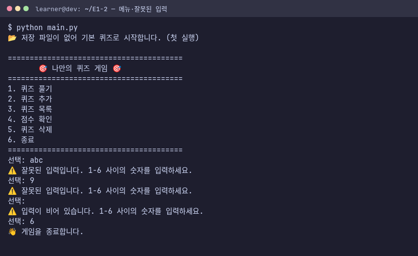
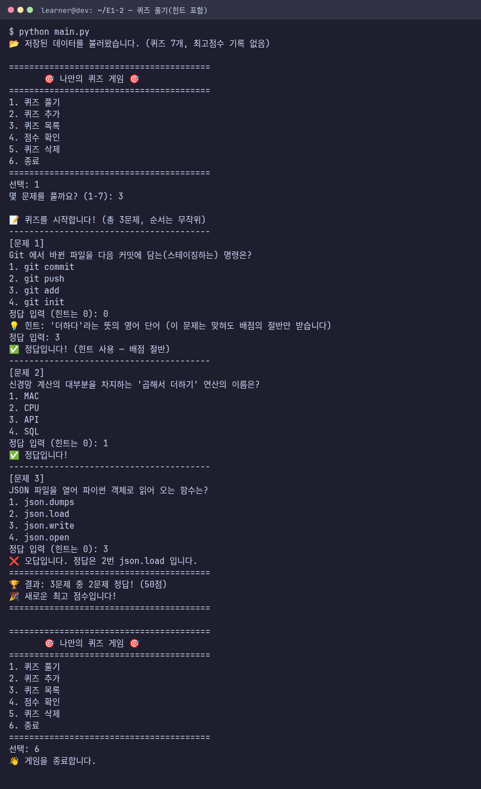
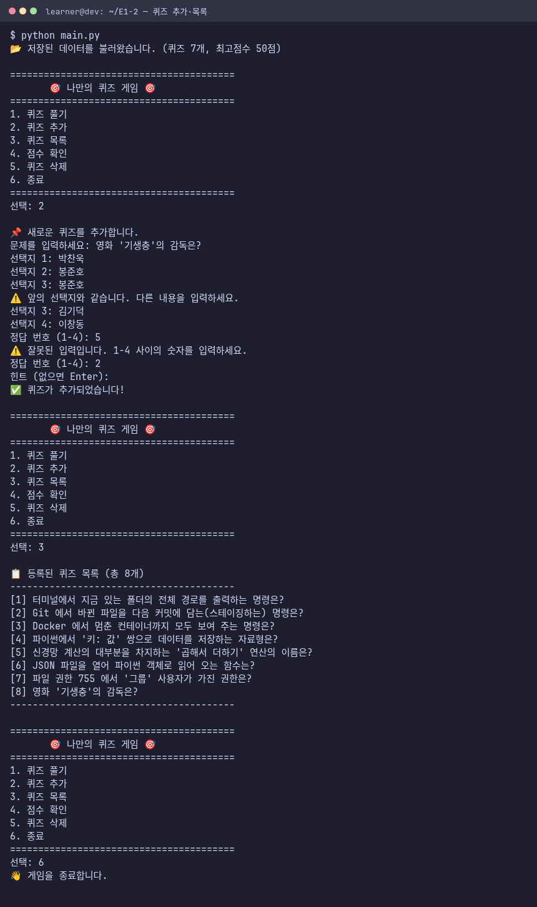
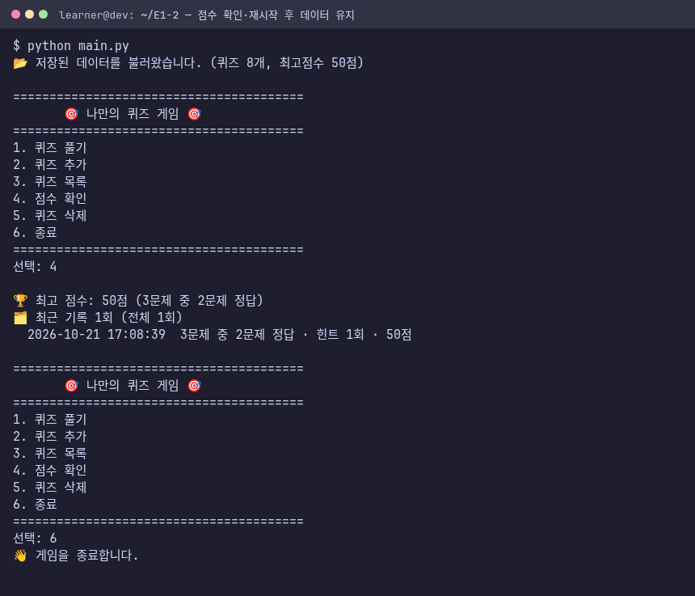
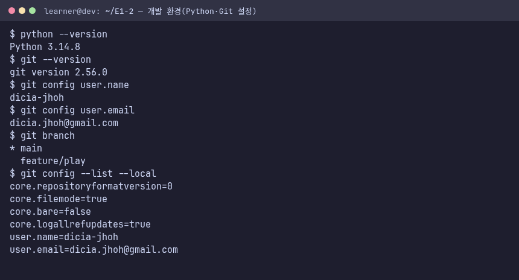
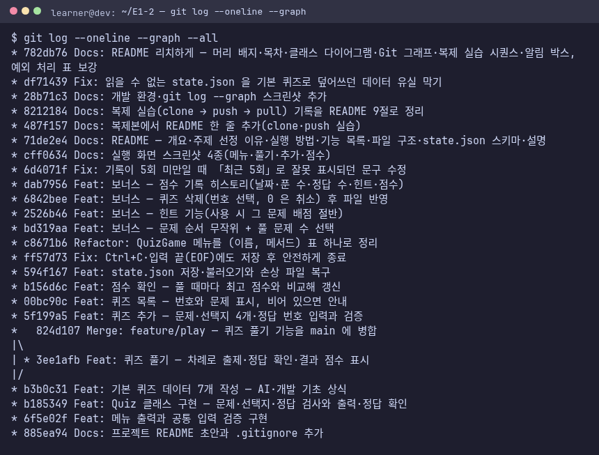

# 나만의 퀴즈 게임 — AI·개발 기초 상식

AI올인원 입학연수 · 개발 입문 E1-2 (미션 185001)

## 1. 프로젝트 개요
파이썬 콘솔에서 돌아가는 4지선다 퀴즈 게임이다. 메뉴에서 번호를 골라 **퀴즈 풀기 · 추가 · 목록 · 점수 확인 · 삭제**를 한다.
추가한 퀴즈와 최고 점수, 게임 기록은 프로젝트 루트의 `state.json` 에 저장되어 **껐다 켜도 남는다.**
외부 라이브러리 없이 표준 라이브러리(`json`, `os`, `random`, `time`)만 쓴다.

## 2. 퀴즈 주제와 선정 이유
**주제: AI·개발 기초 상식** — 터미널, Git, Docker, Python 자료형, JSON, 파일 권한, MAC 연산에서 한 문제씩(기본 7문제).

입학 연수 개발 입문은 「작업실 꾸미기(터미널·Docker·Git) → 파이썬 → AI 계산기(MAC)」 순서로 간다.
이 퀴즈는 그 길에서 꼭 외워 둬야 하는 명령과 개념을 문제로 만들었다. 게임을 만드는 동안 퀴즈 내용이
곧 복습이 되고, 완성한 뒤에는 다음 미션을 준비하는 자기 점검 도구로 쓸 수 있다.

## 준비물
- Python 3.10 이상(확인: `python --version`). 이 저장소는 Python 3.14.8 에서 개발·확인했다.
- Git 2.x(확인: `git --version`). 개발 환경은 git 2.56.0.
- 추가로 설치할 패키지 없음.
- 전제 지식: 터미널에서 폴더 이동(`cd`)과 명령 실행.

## 따라 하기
1. 저장소를 받는다: `git clone <저장소 주소> && cd E1-2`
2. 게임을 실행한다: `python main.py`
3. `3` 을 눌러 기본 퀴즈 7개를 확인하고, `1` → 풀 문제 수(예: `3`)를 넣어 퀴즈를 푼다. 모르면 `0` 으로 힌트를 본다.
4. `2` 로 퀴즈를 하나 추가하고 `6` 으로 종료한다.
5. 다시 `python main.py` 를 실행해 「📂 저장된 데이터를 불러왔습니다 (퀴즈 8개 …)」가 나오는지 확인한다.

## 3. 실행 방법
```bash
python main.py
```
- 메뉴 번호(1~6)를 입력하고 Enter. 숫자가 아니거나 범위를 벗어나면 안내 후 다시 묻는다.
- `Ctrl+C` 나 `Ctrl+D`(입력 끝)를 눌러도 오류 화면 없이 **저장 후 종료**한다.
- 데이터 파일은 `main.py` 옆의 `state.json`. 지우면 다음 실행 때 기본 퀴즈로 다시 시작한다.

## 4. 기능 목록

| 메뉴 | 기능 | 처리하는 예외 |
|---|---|---|
| 1. 퀴즈 풀기 | 풀 문제 수를 고르면 무작위 순서로 출제, 정답/오답 안내, 결과 점수, 최고 점수 갱신 | 퀴즈 0개, 문제 수 범위 밖, 정답 번호 0~4 밖 |
| 2. 퀴즈 추가 | 문제·선택지 4개·정답 번호·힌트(선택)를 받아 등록하고 바로 저장 | 빈 칸, 앞과 같은 선택지, 정답 번호 1~4 밖 |
| 3. 퀴즈 목록 | 등록된 문제를 번호와 함께 표시 | 퀴즈 0개 |
| 4. 점수 확인 | 최고 점수(맞힌 수 포함)와 최근 기록 5회 | 아직 안 풀었음 |
| 5. 퀴즈 삭제 | 목록에서 번호를 골라 삭제(0 = 취소)하고 저장 | 퀴즈 0개, 번호 범위 밖 |
| 6. 종료 | 저장하고 끝냄 | — |

**공통 입력 기준**(`quiz_game/inputs.py` 한 곳에서 처리)

| 입력 | 처리 |
|---|---|
| ` 1 ` (앞뒤 공백) | 공백을 지우고 `1` 로 처리 |
| `abc` (숫자 아님) | 「⚠️ 잘못된 입력입니다. 1-6 사이의 숫자를 입력하세요.」 후 다시 묻기 |
| `9`, 정답 `0` (범위 밖) | 같은 안내 후 다시 묻기(힌트가 있는 문제에서만 정답 `0` = 힌트) |
| 그냥 Enter (빈 입력) | 「⚠️ 입력이 비어 있습니다 …」 후 다시 묻기 |
| `Ctrl+C`, `Ctrl+D` | 「⚠️ 입력이 중단되어 … 저장하고 종료합니다.」 |
| 손상된 `state.json` | 「⚠️ state.json 이 손상되어 기본 퀴즈로 복구합니다.」, 손상 파일은 `state.json.broken` 으로 보관 |

**점수 규칙**: 100점 만점을 푼 문제 수로 나눠 한 문제 배점을 정한다. 힌트를 본 문제는 맞혀도 배점의 절반(`HINT_RATE = 0.5`).
예: 3문제 중 1문제는 힌트 보고 정답, 1문제 정답, 1문제 오답 → 16.7 + 33.3 = 50점.

**보너스 구현**: 랜덤 출제, 문제 수 선택, 힌트(감점), 퀴즈 삭제, 점수 기록 히스토리 — 5개 전부.

## 5. 실행 화면
스크린샷은 실제 프로그램 출력이다. 입력은 사람이 치는 대신 스크립트가 넣었고(입력값이 프롬프트 뒤에 그대로 찍힌다),
그 출력을 터미널 모양 이미지로 렌더링했다.

| 메뉴·잘못된 입력 | 퀴즈 풀기(힌트) |
|---|---|
|  |  |
| **퀴즈 추가·목록** | **점수 확인·재시작 후 데이터 유지** |
|  |  |

**개발 환경과 Git 이력**

| 개발 환경(Python·Git 설정) | `git log --oneline --graph` |
|---|---|
|  |  |

## 6. 파일 구조
```text
.
├── main.py              # 진입점 — state.json 경로를 정하고 게임 실행, Ctrl+C·EOF 처리
├── state.json           # 퀴즈·최고 점수·기록 저장 파일(프로젝트 루트)
├── quiz_game/
│   ├── quiz.py          # Quiz 클래스 — 한 문제(문제·선택지·정답·힌트)
│   ├── game.py          # QuizGame 클래스 — 메뉴와 풀기/추가/목록/점수/삭제, 저장 연동
│   ├── storage.py       # StateStore 클래스 — state.json 읽기·쓰기·손상 복구
│   ├── inputs.py        # 공통 입력 검증(ask_int, ask_text)
│   └── defaults.py      # 기본 퀴즈 7개
└── docs/screenshots/    # 실행 화면
```
클래스 3개가 역할을 나눈다: **Quiz**(데이터 한 건) · **QuizGame**(게임 진행) · **StateStore**(파일 저장).
`json`·`os` 를 쓰는 곳은 `storage.py` 하나뿐이라, 저장 방식을 바꿔도 게임 코드는 그대로다.

## 7. 데이터 파일 — `state.json`
- **경로**: 프로젝트 루트(`main.py` 와 같은 폴더). `main.py` 가 자기 위치를 기준으로 경로를 만들어 어느 폴더에서 실행해도 같은 파일을 쓴다.
- **역할**: 퀴즈 목록, 최고 점수, 게임 기록을 보관해 프로그램을 다시 켜도 이어지게 한다.
- **인코딩**: UTF-8(한글 그대로 저장, `ensure_ascii=False`).
- **저장 시점**: 첫 실행(기본 퀴즈), 퀴즈 추가·삭제, 게임 결과, 종료, Ctrl+C.
- **안전한 저장**: `state.json.tmp` 에 다 쓴 뒤 `os.replace` 로 바꿔치기한다. 쓰는 도중 끊겨도 원본이 반쯤 덮이지 않는다.

```json
{
  "quizzes": [
    {
      "question": "터미널에서 지금 있는 폴더의 전체 경로를 출력하는 명령은?",
      "choices": ["ls", "pwd", "cd", "mkdir"],
      "answer": 2,
      "hint": "print working directory 의 줄임말"
    }
  ],
  "best_score": {"score": 50, "correct": 2, "total": 3},
  "history": [
    {"played_at": "2026-10-21 17:08:39", "total": 3, "correct": 2, "hints": 1, "score": 50}
  ]
}
```

| 필드 | 타입 | 뜻 |
|---|---|---|
| `quizzes` | list | 퀴즈 목록. 각 항목은 `question`(str) · `choices`(str 4개) · `answer`(1~4 정수) · `hint`(str, 없으면 "") |
| `best_score` | dict 또는 null | 최고 점수 `score`(0~100) 와 그때 `correct`/`total`. 아직 안 풀었으면 `null` |
| `history` | list | 게임마다 시각·푼 수·맞힌 수·힌트 사용 수·점수 |

형식이 틀린 퀴즈 항목은 건너뛰고(개수 안내), `hint` 가 없는 예전 파일도 그대로 읽는다.

## 8. Git 작업 기록
기능 하나를 끝낼 때마다 커밋했다(`Feat:` 기능 · `Fix:` 버그 · `Refactor:` 구조 · `Docs:` 문서 · `Chore:` 설정).
퀴즈 풀기는 `feature/play` 브랜치에서 만들고 `main` 으로 병합했다(`git checkout -b feature/play` → 작업·커밋 → `git checkout main` → `git merge --no-ff feature/play`).

| Git 명령 | 이 저장소에서 쓴 곳 |
|---|---|
| `init` | 저장소 처음 만들 때 `git init -b main` |
| `add` | 커밋마다 바뀐 파일 스테이징 |
| `commit` | 기능 단위 커밋 |
| `checkout` | `feature/play` 브랜치 만들기·이동, `main` 으로 돌아오기 |
| `push` · `clone` · `pull` | 9절 복제 실습 |

## 9. 복제 실습(clone → push → pull)
원문 13번 절차를 그대로 했다. 이 단계는 **로컬 초안** 단계라 GitHub 대신 같은 컴퓨터의 빈 원격 저장소
(`git init --bare`)를 원격으로 썼다. 명령과 흐름은 GitHub 와 같고, 저장소를 GitHub 에 올릴 때 원격 주소만 바뀐다.

1. 원격을 연결하고 `main` 을 `push` 한다.
2. 원격을 다른 폴더(`E1-2-clone`)로 `clone` 한다.
3. 복제본에서 README 에 한 줄을 추가하고 `commit` → `push` 한다.
4. 원래 작업 폴더에서 `pull` 해 그 한 줄이 들어왔는지 확인한다.

```text
$ git remote add origin <원격 저장소>
$ git push -u origin main
To <원격 저장소>
 * [new branch]      main -> main
branch 'main' set up to track 'origin/main'.
$ git clone <원격 저장소> E1-2-clone
(복제 완료)
$ git add README.md
$ git commit -m Docs: 복제본에서 README 한 줄 추가(clone·push 실습)
[main 487f157] Docs: 복제본에서 README 한 줄 추가(clone·push 실습)
 1 file changed, 2 insertions(+)
$ git push
To <원격 저장소>
   71de2e4..487f157  main -> main
$ git pull
From …/e12-remote
   71de2e4..487f157  main       -> origin/main
Updating 71de2e4..487f157
Fast-forward
 README.md | 2 ++
 1 file changed, 2 insertions(+)
$ tail -2 README.md

> 복제본(clone)에서 추가한 줄 — push 후 원래 작업 폴더에서 pull 로 받았다.
$ git log --oneline -3
487f157 Docs: 복제본에서 README 한 줄 추가(clone·push 실습)
71de2e4 Docs: README — 개요·주제 선정 이유·실행 방법·기능 목록·파일 구조·state.json 스키마·설명
cff0634 Docs: 실행 화면 스크린샷 4종(메뉴·풀기·추가·점수)
```
`pull` 이 Fast-forward 로 커밋 `487f157` 을 받아 왔고, README 끝에 복제본에서 쓴 줄이 생겼다(그 줄은 이 절로 옮겼다).
실습이 끝난 뒤 임시 원격 연결(`origin`)은 지웠다 — GitHub 에 올리는 단계에서 실제 주소로 다시 연결한다.

## 10. 설명

### Python 기초
| 주제 | 설명과 이 코드에서의 예 |
|---|---|
| 변수 | 값에 이름을 붙여 두는 상자. 같은 값을 여러 번 쓰고, 바뀌는 값을 추적한다. 예: `correct` 가 맞힌 수를 문제마다 1씩 늘려 기억한다. |
| 자료형 | `int` 정수(정답 번호 `2`), `str` 글자(문제 문장), `bool` 참/거짓(`quiz.is_correct()` 결과), `list` 순서 있는 묶음(선택지 4개), `dict` 이름표 붙은 묶음(`state.json` 의 퀴즈 한 건). |
| 조건문 | `if/elif/else` 로 경우마다 다른 일을 한다. 예: 입력이 비었으면 → 안내, 숫자가 아니면 → 안내, 범위 밖이면 → 안내, 아니면 값 반환(`ask_int`). |
| 반복문 | `for` 는 정해진 묶음을 차례로(문제 목록 출제), `while` 은 조건이 맞을 때까지(올바른 입력이 올 때까지 다시 묻기, 메뉴 반복). 횟수를 미리 알면 `for`, 모르면 `while`. |
| 함수 | 이름 붙인 작업 단위. 매개변수로 받고 반환값으로 돌려준다. 예: `ask_int(prompt, low, high)` 는 범위를 받아 검증된 정수를 돌려준다. |

### 클래스와 객체
| 주제 | 설명과 이 코드에서의 예 |
|---|---|
| 클래스 | 데이터와 그 데이터를 다루는 기능을 한 덩어리로 묶는 설계도. 퀴즈 하나의 문제·선택지·정답과 「출력」「정답 확인」을 `Quiz` 로 묶어, 어디서든 같은 방식으로 다룬다. |
| `__init__` 과 `self` | `__init__` 은 객체를 만들 때 한 번 실행되어 속성을 채운다(여기서는 값 검사까지). `self` 는 「지금 이 객체」 — `self.answer` 는 이 퀴즈의 정답. |
| 속성과 메서드 | 속성 = 객체가 가진 값(`question`, `choices`, `answer`, `hint`). 메서드 = 객체가 하는 일(`display()`, `is_correct()`, `to_dict()`). |

### 파일 입출력
| 주제 | 설명과 이 코드에서의 예 |
|---|---|
| 파일 열기·읽기·쓰기 | `with open(경로, "w", encoding="utf-8") as f:` 로 열고, 블록이 끝나면 자동으로 닫힌다. 읽기는 `"r"`(기본), 쓰기는 `"w"`. |
| JSON | 사람이 읽을 수 있는 글자로 리스트·딕셔너리를 저장하는 형식. 파이썬 `dict`/`list` 와 1:1 로 바뀌어(`json.dump`/`json.load`) 다시 읽기 쉽고, 다른 언어·도구도 읽는다. |
| `try/except` | 오류가 날 수 있는 코드를 감싸 프로그램이 멈추지 않게 한다. 예: 파일 없음(`FileNotFoundError`) → 첫 실행 처리, 손상(`JSONDecodeError`) → 복구, 숫자 변환 실패(`ValueError`) → 다시 묻기. |

### Git 기초
| 주제 | 설명 |
|---|---|
| Git 이란 | 파일의 변경 이력을 저장하는 버전 관리 도구. 언제·무엇을·왜 바꿨는지 남고, 망가지면 이전 상태로 돌아갈 수 있으며, 여러 사람이 동시에 작업할 수 있다. |
| `init` | 지금 폴더를 Git 저장소로 만든다(`.git` 폴더 생성). |
| `add` | 바뀐 파일을 다음 커밋에 담는다(스테이징). |
| `commit` | 스테이징한 변경을 메시지와 함께 이력에 한 칸 저장한다. |
| `push` | 내 커밋을 원격 저장소로 올린다. |
| `pull` | 원격 저장소의 새 커밋을 내려받아 내 브랜치에 합친다. |
| `checkout` | 다른 브랜치(또는 커밋)로 이동한다. `-b` 를 붙이면 새 브랜치를 만들면서 이동한다. |
| `clone` | 원격 저장소 전체(이력 포함)를 내 컴퓨터에 복사한다. |
| 브랜치·병합 | 브랜치는 본선(`main`)을 건드리지 않고 따로 작업하는 갈래. 다 되면 `merge` 로 본선에 합친다(8절). |

## 용어 사전
- **4지선다**: 선택지 4개 중 하나를 고르는 문제 형식.
- **스테이징**: 다음 커밋에 넣을 변경을 골라 두는 단계(`git add`).
- **원격 저장소**: 내 컴퓨터 밖(GitHub 등)에 있는 같은 저장소. `push`·`pull` 의 상대.
- **EOF**: 입력의 끝(End Of File). 터미널에서 `Ctrl+D`.
- **원자적 저장**: 다 쓰거나 아예 안 쓰거나 — 임시 파일에 쓴 뒤 한 번에 바꿔치기하는 저장 방식.

## 11. 과정 연결
- 입학 연수 2주차 시험(Python과 Git 기초)은 클래스·메뉴 프로그램·브랜치 병합을 다시 묻는다. 시험 중 하나는
  `import` 를 아예 막기 때문에, 이 게임의 퀴즈 로직(`quiz.py`, `inputs.py`)은 import 없이 짰다.
- 본과정 「Python과 Git 심화」의 용돈 기입장 미션이 이 구조(모델 클래스 · 저장소 클래스 · 화면/입력)를 그대로 키운다.
